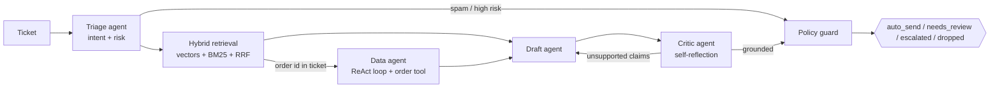

# AgentDesk


**Live demo:** https://agentdesk.jollycliff-05334aa1.centralindia.azurecontainerapps.io/docs (Azure Container Apps; the public instance runs the offline deterministic test model, so it never spends API credit. First request after idle takes ~30 s.)

A multi-agent support-ticket copilot. It reads a customer ticket, triages it, retrieves facts from
structured and unstructured data, looks up the customer's order with a secure tool, drafts a cited
reply, fact-checks that reply with a critic agent, and decides whether to **auto-send**, send for
**human review**, **escalate**, or **drop** it.

Built with Python, LangGraph, ChromaDB and FastAPI; LLM providers: Gemini API, Azure OpenAI, Vertex AI, or an offline test model. Containerised with Docker, tested and built by GitHub Actions, deployed on Azure Container Apps. Every LLM call is traced
(tokens, tokens/sec, cost, latency) and the whole system is covered by 45 tests and an evaluation harness.

## How it works



| Piece | What it does |
|---|---|
| **Triage (supervisor)** | Classifies intent and risk; flags spam, legal threats and prompt injection. Fails closed: unparseable output escalates. |
| **Hybrid RAG** | ChromaDB vector search + BM25 keyword search fused with Reciprocal Rank Fusion. Heading-aware chunking. Tenant-isolated. Ingests Markdown (unstructured) and CSV rows (structured). |
| **Data agent (ReAct)** | Bounded Reason-Act loop that calls an order-lookup tool. Parameterised SQL; the tool only returns orders owned by the authenticated customer. |
| **Draft + critic (self-reflection)** | The critic checks every claim against the retrieved sources and sends ungrounded drafts back for a rewrite (bounded loop). |
| **Policy guard** | Masks emails, phone and card numbers; decides the outcome (refunds always go to a human). |
| **Tracing** | Per-agent spans with prompt/completion tokens, tokens/sec, estimated cost and latency; state is checkpointed per run. |

## Quickstart (Windows PowerShell)

```powershell
python -m venv .venv
.venv\Scripts\Activate.ps1
pip install -r requirements.txt
python -m pytest -q                       # 45 tests, offline
$env:PYTHONPATH="."
python -m evals.run_eval                  # eval on the offline mock model
python -m uvicorn app.api.main:app --port 8000
```
Open http://localhost:8000/docs and try:
```json
{"ticket": "Where is my order ORD-1001?", "customer_id": "CUST-1"}
```
Use `customer_id: "CUST-2"` and the order is not found: access control is enforced inside the tool.

### Using real Gemini (free API key)
```powershell
$env:GEMINI_API_KEY="<your key from aistudio.google.com>"   # never commit it
$env:LLM_PROVIDER="gemini"
$env:LLM_MODEL="gemini-3.8-flash"
python -m evals.run_eval
```
The free tier allows very few requests per day, so answers are cached in `.llm_cache/` and the eval
stops cleanly when the quota is hit; run it again after the reset and finished tickets replay for free.

## API

| Endpoint | Purpose |
|---|---|
| `POST /v1/resolve` | Run the workflow on one ticket |
| `GET /v1/runs/{run_id}` | Full per-agent trace of a past request |
| `GET /v1/metrics` | Rolling latency / cost / outcome aggregates |
| `GET /health` | Liveness |

Optional `X-API-Key` auth, per-IP rate limiting, strict input validation.

## Evaluation

`python -m evals.run_eval` runs 18 tickets (12 normal, 6 adversarial: prompt injection, reading another
customer's order, spam, legal threats, out-of-scope questions, unauthenticated access) and gates on intent
accuracy, retrieval hit rate, answer coverage, outcome accuracy, safety and groundedness.
`--stress-hallucination` forces a made-up claim into every first draft to prove the critic loop removes it.

| Run | Result |
|---|---|
| Offline mock model, 18 tickets | All gates pass. This is a regression suite for the pipeline logic, **not** a measure of model quality. |
| Gemini (`gemini-3.8-flash`), first 3 tickets | 3/3 correct, 0 errors. Median latency ~41 s per ticket (thinking model + deliberate throttling for the free tier). Sample is too small to draw conclusions. |
| Gemini, full 18 tickets | In progress (free-tier daily quota). |

## Design decisions
- **Hybrid retrieval**: BM25 catches exact tokens such as error codes (`E-4102`) that embeddings blur; RRF merges rankings without calibrating score scales.
- **Authorization in the tool, not the prompt**: a prompt-injected ticket cannot read another customer's order.
- **Fail closed**: unparseable model output, missing context or ungrounded drafts escalate to a human instead of sending.
- **Pluggable LLM / embedder interfaces**: the same agents run offline (deterministic mock), on the Gemini API, or on Vertex AI.
- **Record/replay cache**: makes quota-limited evaluation repeatable and cheap.

## Limitations (honest)
- The knowledge base is tiny (4 documents, 3 plan rows); retrieval scores say little about scale.
- The offline mock model is a test double built to exercise the pipeline; its scores are not model quality.
- `customer_id` and `tenant` come from the request body for demo purposes; in production they must come from the authenticated identity.
- Chroma storage is local and ephemeral on most free hosts; the app re-ingests the sample data at startup.
- Estimated cost uses list prices in `app/llm/base.py` that may be out of date; free-tier usage is actually free.
- The public demo runs the offline test model (no LLM); real-model results come from the evaluation runs below, not from the demo link.

## Layout
```
app/agents/     LangGraph workflow, agent nodes, prompts
app/rag/        chunking, embeddings, Chroma store, BM25, hybrid retriever, ingestion
app/llm/        Gemini / Vertex / mock clients, response cache
app/tools/      order lookup tool + demo data seeding
app/observability/  tracing + metrics
app/api/        FastAPI service
evals/          dataset + evaluation harness
tests/          45 tests
```
